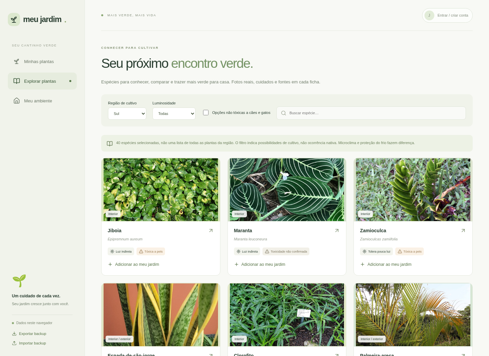

# Meu jardim

**Um espaço para cultivar plantas, conhecimento e uma rotina de cuidado.**

Meu jardim nasceu de uma ideia simples: ajudar alguém querido a acompanhar as plantas de casa. A proposta é transformar o cuidado diário em uma experiência acessível, visual e acolhedora — e evoluir para uma plataforma onde cada pessoa tenha seu próprio jardim digital.

Fotografias do catálogo: [autores e licenças](src/assets/plants/CREDITS.md).

## Cultivar com mais confiança

Reúna suas plantas em uma coleção com fotos, nomes e histórias. Registre os cuidados, acompanhe o tempo que cada planta está com você e encontre orientações para observar suas necessidades.

Explore espécies, descubra suas preferências de luz e consulte informações sobre toxicidade para cães e gatos. Para escolher uma nova companheira, descreva o ambiente da casa e encontre opções compatíveis com ele.

## Como usar

1. Abra o site pelo endereço disponível na seção **About** deste repositório ou no ambiente **github-pages**.
2. Entre em **Minhas plantas** e adicione sua primeira planta, com foto e data de aquisição.
3. Registre as regas e outros cuidados para construir seu diário.
4. Visite **Explorar plantas** para conhecer espécies e **Meu ambiente** para encontrar combinações com a sua casa.
5. Use **Exportar backup** para guardar uma cópia do jardim.

Quando a conexão com o serviço de contas estiver ativada, **Entrar / criar conta** permite cadastrar e-mail e senha, confirmar o endereço e acessar o jardim em outros aparelhos. O modo local continua disponível para experimentar sem cadastro; as plantas locais podem ser copiadas para a conta por uma importação manual.

## Uma experiência que cresce

A visão do projeto inclui identificação de espécies por foto, recomendações para ambientes, lembretes personalizados e um catálogo cada vez mais completo de plantas presentes nas casas brasileiras. Essas frentes fazem parte da evolução do produto e serão lançadas após validação de qualidade, privacidade e custos.

O visual combina tons verdes suaves, elementos botânicos e uma interface pensada para funcionar no celular e no computador. O nome é provisório; a prioridade é construir uma experiência útil e confiável.

## Cuidado com as plantas e com seus dados

O jardim local pertence ao navegador usado. Na experiência com conta, os dados ficam vinculados ao usuário e protegidos por regras de acesso no banco e no armazenamento de fotos. Dados pessoais e fotos dos usuários não fazem parte do repositório público.

As orientações de cultivo ajudam a observar a planta: a necessidade de água varia com o vaso, o substrato, o clima e a estação. A identificação correta da espécie também importa para a segurança de animais. Consulte as fontes de cada ficha e procure um veterinário em caso de ingestão.

## Por dentro do projeto

Construído com **React**, **Vite** e **Supabase**, com publicação da interface pelo **GitHub Pages**. Autenticação e armazenamento são serviços separados da hospedagem da interface, o que permite adotar um domínio próprio no futuro.

Para desenvolvimento e configuração, consulte a [documentação técnica](docs/DEVELOPMENT.md), a [ativação de contas](docs/SUPABASE.md), a [política editorial do catálogo](docs/CATALOG.md) e os [cuidados de segurança](docs/SECURITY.md).
