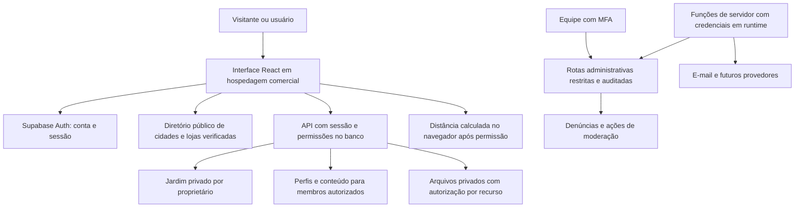
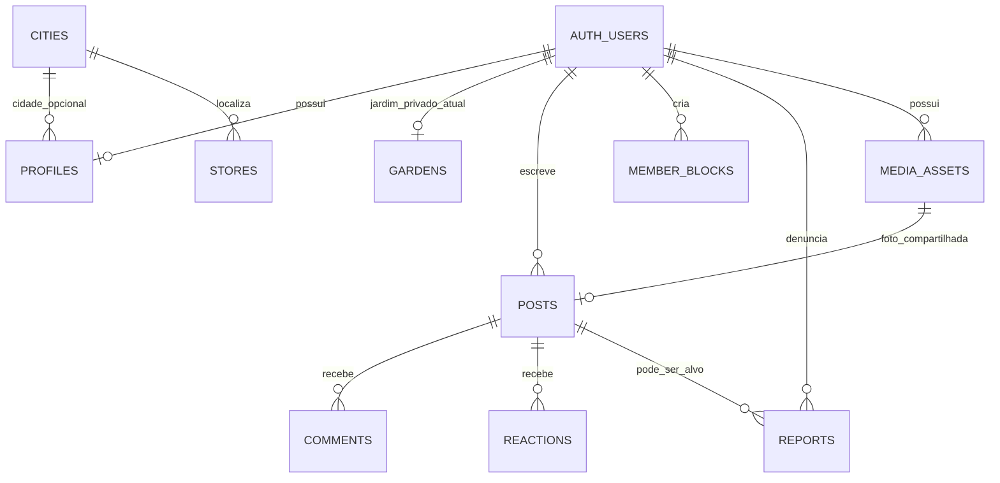

# Arquitetura da primeira versão comercial

Decisões técnicas para o [escopo do produto](PRODUTO.md). Esta entrega contém a revisão do protótipo, o plano incremental e a primeira migração aditiva de perfis e cidades, validada localmente. Não publica a comunidade nem aplica SQL no projeto Supabase real.

## Decisão principal

Manter React/Vite e Supabase/PostgreSQL para a primeira versão. Reaproveitar o jardim privado; adicionar a comunidade por módulos separados. Não é necessário reconstruir todo o produto nem contratar AWS nesta etapa.

Mover a interface para uma hospedagem com condições adequadas ao uso comercial, como Cloudflare Pages, depois da escolha de domínio e planos. Confirmar contratos e preços antes de contratar. O protótipo no GitHub Pages continua separado desse lançamento.

O diagrama descreve o destino da arquitetura. Feed, mídia comunitária, lojas e administração ainda não estão implementados nesta entrega. A Publishable key do Supabase é pública; permissões no banco e no backend são a fronteira de segurança.

## Revisão do código atual

| Parte inspecionada                         | Decisão                                                  | Trabalho necessário                                                                                                                 |
| ------------------------------------------ | -------------------------------------------------------- | ----------------------------------------------------------------------------------------------------------------------------------- |
| `src/lib/supabase.js` e `public-config.js` | Reaproveitar cliente e validação de configuração pública | Centralizar ciclo de sessão em um provider; testar restauração, recuperação e troca de usuário                                      |
| `src/lib/cloud-garden.js`                  | Preservar adaptador e controle de revisão                | Limitar acesso por módulo; revisar falhas parciais e limpeza de fotos; evitar downloads de todas as fotos ao abrir um jardim grande |
| `src/storage.js`                           | Manter dados locais e exportação                         | Não enviar dados locais automaticamente para uma conta; não usar transformação no navegador como única validação de fotos           |
| `src/catalog.js`, catálogo e créditos      | Reaproveitar fichas e atribuições                        | Revisão editorial contínua; manter classificação desconhecida explícita                                                             |
| `src/main.jsx`                             | Separar responsabilidades progressivamente               | Extrair sessão, jardim, formulários e navegação, preservando os testes; introduzir rotas compartilháveis antes de perfis e lojas    |
| Migrações de `gardens` e `plant-photos`    | Preservar contrato e políticas existentes                | Não tornar um jardim público para publicar no feed; ampliar testes de exclusão e isolamento no serviço real                         |
| `supabase/functions/delete-account`        | Reaproveitar validação de sessão e confirmação           | Confirmar publicação real; ampliar remoção de arquivos quando novos buckets existirem; definir retenção de evidências e backups     |
| Auditoria e testes                         | Reaproveitar e ampliar                                   | Checagem de credenciais é baseada em padrões; testar também acesso entre contas reais, uploads e recuperação                        |
| Workflows e branch protegida               | Manter PRs e restrições                                  | Esta entrega extrai a configuração de testes de PR do trabalho separado de lembretes, sem incorporar código ou SQL de agendamento   |

A interface atual não contém perfis sociais, feed ou diretório real de estabelecimentos. Não considerar o planejamento como evidência de funcionamento dessas partes.

## Limites entre módulos

Separar gradualmente `auth`, `garden`, `community`, `directory` e `moderation`. Cada módulo terá componentes, operações de dados e testes próprios. O cliente Supabase continua encapsulado nos adaptadores; componentes não devem receber credenciais administrativas.

Usar rotas como `/jardim`, `/comunidade`, `/perfil/:handle`, `/lojas` e `/lojas/:slug` ao introduzir navegação por URL. A escolha e configuração do roteador serão feitas em uma entrega de interface, com teste de acesso direto, recarregamento e retorno da confirmação de e-mail. Não migrar rotas sem atualizar a configuração de hospedagem e os redirecionamentos do Auth.

Operações simples de leitura e escrita podem usar o cliente autenticado com RLS e concessões de coluna. Funções de servidor são necessárias para processamento de mídia, tarefas administrativas, e-mails e outros provedores. Consultas privilegiadas não devem usar um ID de solicitante enviado pelo navegador; a identidade vem da sessão verificada.

## Primeira migração: perfis e cidades

Arquivo: `supabase/migrations/202611040001_community_foundation.sql`.

- `cities`: quatro cidades iniciais, consultáveis por visitantes e membros. Escrita reservada à operação autorizada.
- `profiles`: ID do proprietário, identificador único, nome de exibição, apresentação e cidade opcional. Não contém e-mail, telefone, senha, papel administrativo ou coordenadas pessoais.
- `member_blocks`: cada conta gerencia os bloqueios que criou; a conta bloqueada não lista esses registros. A leitura de perfis é negada nos dois sentidos.
- `app_private.community_account_status`: estado de suspensão separado do perfil, inacessível para escrita pelo cliente. Não é uma lista pública de usuários nem um campo editável de perfil.
- Helpers de autorização com `search_path` fixo, identidade extraída da sessão e execução restrita. Não adicionar `app_private` aos schemas expostos da API.

Somente contas confirmadas e não suspensas podem criar ou alterar perfis. Suspensão da comunidade não concede acesso a jardins alheios nem apaga o jardim próprio. A conta suspensa pode consultar seu próprio perfil para gerenciar dados; uma conta marcada como excluída não pode continuar consultando perfis usando uma sessão antiga.

Os identificadores têm validação e unicidade no banco, inclusive em requisições concorrentes. Alguns nomes institucionais são reservados. Isso não elimina a possibilidade de imitação por nome ou foto: distintivos de equipe deverão vir de permissões do servidor, nunca do nome escolhido.

Nenhuma loja fictícia é cadastrada. A migração não modifica `gardens`, `plant-photos` ou a autenticação existente. Não cria buckets novos e não libera uploads de avatar antes de existir um fluxo validado.

## Modelo futuro da comunidade

O diagrama inclui entidades futuras, não tabelas já liberadas. Definir uma publicação com texto e, inicialmente, uma foto. Comentários devem ter o mesmo limite de leitura da publicação. Curtidas exigem unicidade por conta e publicação e escrita permitida apenas se a publicação estiver acessível.

Conteúdo removido, suspenso ou bloqueado não deve reaparecer por acesso direto ao ID. O mesmo helper de elegibilidade deverá orientar as políticas de perfil, feed, comentários e mídia. Denúncias ficam separadas do conteúdo: o autor denunciado não recebe a identidade do denunciante.

O feed usa paginação por cursor `(created_at, id)`, com limite imposto no servidor. Consultar a primeira página não deve baixar todo o histórico. Bloqueios, suspensão e moderação são filtrados antes da paginação; não filtrar apenas no navegador depois de retornar conteúdo proibido.

## Jardim e compartilhamento

Manter `gardens` como documento versionado por conta durante essa primeira adição. Normalizar plantas e cuidados somente quando houver uma necessidade demonstrada e uma migração específica testada. Não misturar essa conversão com a abertura da comunidade.

O compositor pode ler uma planta do próprio jardim e copiar apenas texto e foto escolhidos pelo usuário. A publicação não deve incluir notas privadas, histórico completo, caminhos privados ou uma relação consultável por terceiros que permita acessar a origem.

Se for necessário manter a ligação com a planta para o dono, usar uma relação privada, autorizada por proprietário. Excluir ou editar uma planta não publica nada e não deve deixar o post apontando para uma foto privada reutilizada indevidamente. O usuário deve entender que a cópia compartilhada tem um ciclo de exclusão separado.

## Mídia e autorização

Separar jardim, avatar e imagem comunitária por políticas e metadados. No piloto, até a mídia da comunidade exige sessão e autorização sobre o recurso associado.

Uma URL assinada continua utilizável até expirar, mesmo após alguns tipos de bloqueio ou remoção. Para o acesso comunitário inicial, preferir download autenticado com política que confira publicação, bloqueio e estado atuais, transformando a resposta em URL local de objeto para exibição. Revogar URLs locais quando a tela for desmontada. Nenhum mecanismo impede cópias ou screenshots de conteúdo já visto.

Fluxo proposto para novas imagens:

1. Usuário autenticado solicita upload e o servidor verifica tipo de uso, propriedade e cota.
2. Arquivo entra em área privada temporária, sem leitura comunitária.
3. Backend verifica tamanho, formato real, dimensões e capacidade de decodificação, remove metadados desnecessários e gera a imagem autorizada.
4. Somente um arquivo processado e pertencente ao autor pode ser anexado ao perfil ou post.
5. Falhas, uploads órfãos e exclusão precisam de limpeza com prazo e registro mínimo, sem apagar arquivos ainda referenciados.

Selecionar e testar uma biblioteca compatível com o runtime escolhido antes de liberar esse fluxo. Não presumir que bibliotecas nativas de Node funcionam em Edge Functions. O MIME informado pelo cliente e o redimensionamento atual no canvas não substituem a validação no servidor.

## Lojas e proximidade

Criar em uma entrega própria as tabelas de lojas, estado de publicação e metadados de verificação. Publicar somente lojas revisadas; contatos do responsável pela revisão e notas internas ficam fora da tabela pública.

No piloto, os estabelecimentos podem ser consultados por cidade. Quando o usuário autorizar localização, a distância pode ser calculada no próprio navegador usando as coordenadas comerciais dos resultados. Isso evita enviar ou armazenar sua posição exata e dispensa uma API paga de mapas para essa experiência inicial.

Caso o diretório cresça e exija busca geográfica no servidor, avaliar consulta geoespacial e minimização dos dados antes de mudar esse comportamento. A origem da localização e o envio ao servidor precisam ficar claros. Links de rota devem usar o destino comercial e não incluir a posição pessoal em logs ou URLs de perfil.

## Administração e conta

Separar papel de moderador do acesso operacional ao Supabase. O moderador trabalha com denúncias e conteúdo comunitário permitido; não recebe por essa função acesso ao jardim privado.

Rotas administrativas verificam sessão, papel do servidor e MFA. Não basta esconder o painel. Operações privilegiadas usam escopo mínimo, trilha de auditoria e respostas que não exponham chaves ou dados pessoais desnecessários.

O código de exclusão atual remove arquivos de `plant-photos` e exclui o usuário. Novos buckets e regras de retenção devem ser incluídos antes de lançar uploads sociais. As referências de perfis, bloqueios e suspensão da base nova são removidas por cascade quando a conta é excluída fisicamente. Isso não apaga objetos do Storage nem resolve por si só a retenção de backups.

## Ameaças e verificações

| Risco                                        | Controle planejado                                        | Evidência exigida                                                            |
| -------------------------------------------- | --------------------------------------------------------- | ---------------------------------------------------------------------------- |
| Editar o perfil de outra pessoa              | RLS e concessões de coluna                                | Tentativa de A alterar B negada sem depender da interface                    |
| Elevar o próprio privilégio                  | Estado e papéis privados, sem escrita pelo cliente        | Inserção ou alteração de estado pelo usuário negada                          |
| Acesso à comunidade sem confirmação          | Estado de conta lido do Auth no servidor                  | Conta não confirmada não lê perfis alheios nem cria perfil                   |
| Ler jardim ou foto privada pelo perfil       | Separação de dados, caminhos e políticas                  | Contas membros continuam sem acesso aos dados privados de outra conta        |
| Contornar um bloqueio                        | Verificação nos dois sentidos em cada recurso             | Consultas diretas de perfil, post, comentário e mídia não contornam bloqueio |
| Acessar conteúdo após suspensão              | Estado consultado pelo servidor, não pelo perfil editável | Sessão existente deixa de acessar conteúdo comunitário alheio                |
| Publicar arquivo perigoso ou consumir a cota | Processamento e cotas no servidor                         | Upload inválido, excessivo ou fora da cota é recusado                        |
| Expor localização residencial                | Cidade opcional e cálculo local de distância              | Buscar lojas não grava a posição pessoal no perfil ou em logs                |
| Perder fotos na recuperação                  | Backup de objetos além do banco                           | Restauração com imagens reais de teste, em ambiente separado                 |
| Vazamento de credenciais                     | Segredos em runtime do servidor e checagem de artefatos   | Build não inclui credenciais privadas; testes e auditoria executados         |

Nesta entrega, a evidência automatizada cobre a base de perfis/cidades/bloqueios/suspensão e a preservação de jardim e fotos. Não cobre recursos futuros ainda não implementados, entrega de e-mail, configuração do Supabase remoto, MFA administrativo ou restauração de fotos.

## Migração, teste e recuperação

1. Confirmar as migrações anteriores de jardins no ambiente de teste. Não é necessário aplicar o PR de lembretes para esta base.
2. Fazer backup do banco e dos objetos existentes e testar acesso aos dados atuais.
3. Aplicar a migração aditiva em teste, sem copiar dados pessoais de produção para fixtures públicas.
4. Validar com visitantes, duas contas confirmadas e uma não confirmada; testar também bloqueio e suspensão.
5. Confirmar que o jardim e as fotos antigos continuam acessíveis somente ao dono e que a aplicação atual continua funcionando.
6. Implementar a interface de perfis em outro PR, preservando a recuperação e os redirecionamentos de autenticação.
7. Só aplicar em produção após revisão da mudança e validação do ambiente e da recuperação. Este PR não executa SQL remoto.

Como a migração é aditiva e não modifica o jardim, a primeira resposta a uma falha é desativar a funcionalidade social na aplicação e preservar os dados para diagnóstico. Não apagar tabelas de usuários como forma de rollback. Se a função já tiver recebido dados reais, qualquer reversão de esquema precisa de plano específico e cópia recuperável.

## Ordem de implementação

1. Integrar o escopo; revisar nesta base o workflow de verificações de PR. A publicação continua exclusiva da branch principal.
2. Revisar e aplicar a base de perfis/cidades em teste; criar interface de edição de perfil e navegação por URL.
3. Implantar e validar processamento de avatar e fotos e cotas de arquivos.
4. Construir publicação, feed, comentários e curtidas, incluindo autorização e paginação.
5. Implementar denúncias, bloqueio na interface e moderação. Não divulgar o feed antes desses controles.
6. Criar o diretório real com curadoria, cidade e distância local opcional.
7. Validar operação, privacidade, exclusão, e-mail, recuperação e custos antes do piloto.

Compras, migração de hospedagem, alteração de cobrança e publicação de serviços continuam dependendo de uma configuração concreta revisada pelo mantenedor. Lembretes e identificação por foto seguem como frentes separadas do planejamento, com prioridades a confirmar antes dos convites.
