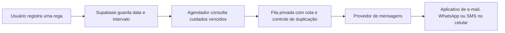

# Lembretes enviados pelo servidor

## Infraestrutura

O projeto já utiliza nuvem: GitHub Pages serve a interface e Supabase oferece autenticação, PostgreSQL, armazenamento de fotos e funções de servidor. Um agendador e um provedor de mensagens podem ser adicionados sem migrar para AWS.

A fila, o envio, o agendamento em produção e a configuração do provedor ainda precisam ser implementados e validados. A base atual não envia mensagens nem está publicada na branch principal.

## Base preparada nesta branch

- Cálculo de calendário considerando dias e fuso, inclusive mudança de horário de verão.
- Preferências privadas por conta, com horário local e consentimento desativado por padrão.
- Consulta de candidatos restrita ao servidor, sem disponibilizar a lista de outros usuários à interface.
- Configuração operacional privada, desativada e com cota zero. A ativação de preferências é recusada enquanto o serviço não estiver configurado.
- Testes de datas, nova rega, consentimento, isolamento e permissões.
- Testes em pull requests; publicação do Pages restrita à branch principal depois da integração.

Não execute a nova migração no projeto real antes da revisão do PR e da conclusão do canal de envio.

## Decisões e requisitos pendentes

O mantenedor escolheu somente serviços gratuitos, com interrupção ao atingir a cota. Nenhuma assinatura, crédito pago ou recurso AWS deve ser ativado sem uma nova decisão explícita.

O canal de envio ainda precisa ser escolhido. E-mail é a opção mais compatível com o piloto gratuito, dependendo da configuração de remetente e das cotas. WhatsApp e SMS normalmente exigem cobrança ou créditos temporários; não assumir gratuidade permanente. Web Push exige suporte e autorização no dispositivo e não atende sozinho ao requisito de independência da instalação do site.

As credenciais do provedor devem ser configuradas no servidor. A configuração SMTP do Supabase Auth não fica automaticamente disponível para uma função que envia lembretes. Nunca copiar senhas SMTP ou chaves administrativas para o build ou para a interface.

## Requisitos antes de ativar envios

1. Escolher e configurar o canal, validar o destinatário e obter consentimento específico para lembretes.
2. Implementar fila, limite global e por usuário e bloqueio na cota. A configuração de limite por si só não implementa a contagem: nenhum worker pode ser habilitado antes dessa etapa.
3. Definir chave de idempotência por conta, planta e ciclo de cuidado. Revalidar o estado atual antes do envio: nova rega ou desativação deve cancelar lembretes pendentes.
4. Diferenciar aceitação pelo provedor de entrega confirmada. Timeouts podem deixar o resultado incerto; não repetir cegamente nem prometer ausência absoluta de duplicações.
5. Registrar falhas sem senhas, tokens ou conteúdo pessoal desnecessário; limitar tentativas e respeitar limites do provedor.
6. Configurar o agendador no servidor e validar com o navegador fechado, usando uma conta e um destinatário de teste autorizados.
7. Testar cancelamento, falhas, cota esgotada, troca de fuso, exclusão de conta e remoção dos dados associados.

## Limites de entrega

Nenhum canal garante 100% de entrega nem de exibição na tela. Mesmo mensagens aceitas podem ser filtradas ou atrasadas. Sem conexão ou com notificações desativadas, o celular pode não exibir um alerta. AWS não elimina essas condições.

Uma mensagem deve pedir para conferir o solo, não ordenar uma rega automática. Exemplo: “Faz sete dias desde a última rega da sua jiboia. Confira a umidade do solo antes de regar novamente.”
